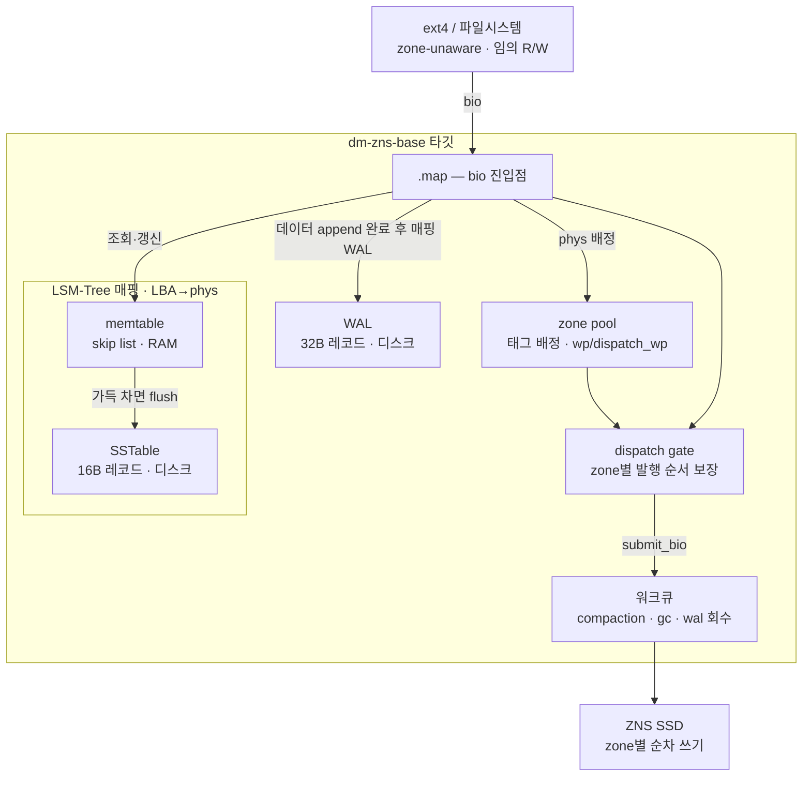
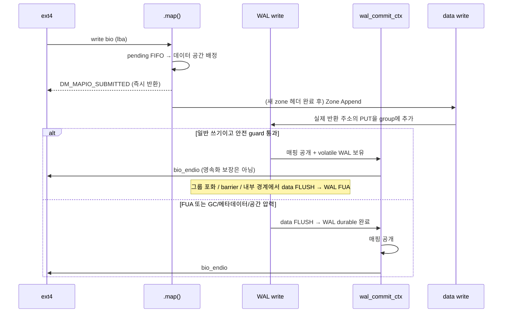
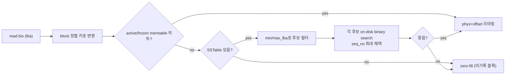

# dm-zns-base

Sequential-only ZNS SSD 위에서 zone-unaware 파일시스템(ext4 등)이 동작하도록,
임의 논리 쓰기(random write)를 Zone Append 기반 물리 순차 쓰기로 변환하는 **LSM-Tree 기반
Device Mapper 타깃**.

최종 개발 브랜치는 **`zns_dm/Kovalt03`**이다. EXT4와 F2FS는 DM이 제공하는 일반
블록 장치 위에서 실행한다. 이는 F2FS의 native ZNS multi-device 구성과 다르다.
실험은 원격 team4 FEMU **게스트 안에서** 수행하며 호스트 장치는 조작하지 않는다.

## 현재 구현 기준

| 영역 | 구현 내용 |
|---|---|
| 쓰기·복구 | 4KiB 매핑, 최대 256KiB data Append, 요청 기반 WAL 영속화와 FLUSH/FUA 경계 |
| 매핑 | active/frozen memtable 조회, SSTable flush·checkpoint·k-way compaction, WAL replay |
| GC 안전성 | 최신 live-map 재확인, relocation 매핑 CAS, read pin, reset 전 참조·workspace 검사 |
| reserve 경계 진행성 | 조건부 seed 차용, GC_DATA tail 단독 소유권 이관, 회수 뒤 foreground 양보 |
| 메타데이터 공간 순환 | WAL 회전·checkpoint 후 회수, SSTable flush/compaction reserve 회전 및 GC와 조정 |
| discard | DELETE/RANGE tombstone WAL 기록·재생; 파일시스템이 요청을 보낼 때 처리 |
| 워크큐 | 동기 WAL 대기 큐와 실제 bio 제출 큐를 분리해 동일 큐 내부 대기 교착 방지 |
| 선택 계측 | `metrics_enabled=1`로 쓰기량·GC·flush·compaction·foreground 대기·매핑 메모리 조회 |

계측과 기능 구현의 존재가 모든 부하의 성능·크래시 정합성 검증 완료를 뜻하지는 않는다.
최근 변경으로 요청 기반 WAL 영속화·다중 page 그룹·압력별 GC를 기본 동작으로
통합하고 구형 OFF/ON 선택기를 제거했다. 결과 비교 시 브랜치명뿐 아니라
사용한 commit, dirty diff, 모듈 SHA-256과 부하기·runner 버전을 함께 기록한다.

> **프로젝트 개요 · 셋업 · Quickstart · 마일스톤 → [docs/project-overview.md](docs/project-overview.md)**
>
> 이 문서(README)는 구현된 타깃의 **아키텍처 · 동작 흐름 · 원리 · 구현 디테일**을 다룬다.

---

## 아키텍처 개요

위 계층(EXT4/F2FS)은 이 타깃을 일반 블록 디바이스로 보고 임의 위치에 읽고 쓴다.
사용자 데이터는 Zone Append의 반환 주소로 매핑하며, positional 메타데이터·GC 쓰기는
dispatch gate로 zone 내 발행 순서를 관리한다. LSM-Tree는 LBA→물리 주소를 추적한다.



**계층별 역할 한 줄 요약**

| 컴포넌트 | 역할 |
|---|---|
| **zone pool** | 물리 zone을 용도별 태그로 배정, `wp`(배정)·`dispatch_wp`(발행) 추적 |
| **memtable** | 최근 LBA→phys 매핑을 담는 in-RAM skip list |
| **WAL** | 데이터 append가 반환한 주소를 group commit — 크래시 복구용 |
| **SSTable** | memtable이 가득 차면 정렬된 매핑을 디스크로 flush한 불변 파일 |
| **compaction** | 오래된 SSTable K개를 병합해 중복 매핑 제거 + read amplification 감소 |
| **GC** | 최신 매핑과 workspace를 확인해 유효 데이터를 이주시키고 zone 회수 |
| **dispatch gate** | 같은 zone에 쓰는 여러 비동기 I/O의 **실제 발행 순서**를 강제 |

---

## 핵심 자료구조

### Zone pool과 zone 태그

물리 zone은 하나의 pool을 공유하고, 각 zone은 **용도 태그**로 구분된다(전용 zone을
영구히 떼어두지 않고 GC/compaction이 회수 — ZenFS 방식).

```c
enum zone_tag {
    ZONE_TAG_FREE = 0,   // 아무도 안 씀 (kcalloc zero-init → 초기 전부 FREE)
    ZONE_TAG_USER_DATA,  // 사용자 데이터
    ZONE_TAG_GC_DATA,    // GC 이주용; 조건 충족 시 tail을 USER_DATA로 단독 이관
    ZONE_TAG_WAL,        // WAL 레코드
    ZONE_TAG_SSTABLE,    // SSTable
    ZONE_TAG_COUNT,      // 배열 크기용
};
```

zone별로 추적하는 두 개의 write pointer가 핵심이다:

| 필드 | 의미 |
|---|---|
| `wp[z]` | **배정된** 섹터 수 (아직 디바이스에 안 나갔을 수 있음) |
| `dispatch_wp[z]` | **실제로 디바이스에 발행된** 섹터 수 (절대 섹터 좌표) |

이 둘을 분리한 이유는 [동시성 모델](#동시성-모델-원리)에서 설명한다.

### LSM-Tree 매핑 (LBA → phys)

매핑은 나이에 따라 세 곳에 나뉘어 산다:

- **memtable** (RAM, skip list): 최근 매핑. 정렬 유지 + O(log n) 조회/삽입.
- **WAL** (디스크): 아직 checkpoint되지 않은 매핑을 기록하고 복구 시 재생한다.
  checkpoint 이전의 매핑은 SSTable과 함께 복원한다.
- **frozen memtable** (RAM): flush 중에도 읽기·GC에 보이도록 유지하며 실패 시
  매핑을 버리지 않고 checkpoint frontier를 fail-closed로 보호한다.
- **SSTable** (디스크): memtable이 `flush_threshold`개를 넘으면 정렬된 채로
  통째 flush된 **불변** 파일. 오래된 매핑이 여기 영구 보관된다.

> **SSTable은 매핑(주소록)만 담는다** — 실제 4KB 사용자 데이터는 데이터 zone에
> 따로 있고, SSTable 레코드의 `phys`가 그 위치를 가리킨다.

### 온디스크 포맷

이식성을 위해 모든 온디스크 필드는 `__le`(리틀엔디안 고정), 접근 시
`cpu_to_le*/le*_to_cpu`로 변환한다.

**zone_header** — 각 zone 섹터 0. 재적재 후 zone 용도 복원의 단서.

```
0        4        8                16
+--------+--------+----------------+
| magic  |  tag   |      gen       |   magic="ZNSH", tag=enum zone_tag,
| le32   | le32   |     le64       |   gen=WAL zone의 배정 순번(그 외 0)
+--------+--------+----------------+
```

**wal_record** — 고정 32B (512/4096에 나머지 없이 나눠떨어짐).

```
0     4     8         16        24        32
+-----+-----+---------+---------+---------+
|type |resv |          union              |   PUT=1, CHECKPOINT=2,
|le32 |le32 |                             |
+-----+-----+---------+---------+---------+
  PUT:        |  lba    |  phys   |  ----   |
  CHECKPOINT: | seq_no  |split_gen|split_off|
```

현재 구현은 GC relocation용 `GC_PUT=3`, discard용 `DELETE=4`와
`DELETE_RANGE=5`도 처리한다. 위 도식은 PUT/CHECKPOINT 필드의 개략도다.
foreground WAL은 4KiB page에 여러 레코드를 묶는다.

CHECKPOINT는 memtable 스왑 시점의 WAL 스트림 위치를 `(split_gen, split_off)`
= (활성 WAL zone의 generation, 그 zone 내 다음 쓰기 오프셋)로 남긴다. replay는
이 지점보다 앞선 PUT은 이미 SSTable에 반영됐다고 보고 건너뛴다.

**sstable_header (40B) + sstable_record (16B)** — 헤더 1섹터 뒤로 레코드가 연속.

```
[Header]  magic("SSTB") | reserved | seq_no | record_count | min_lba | max_lba
[Record0] lba | phys        ← 고정 16B라 offset = i*16 으로 binary search 가능
[Record1] lba | phys
...
```

- `seq_no`: 세대 번호. 같은 LBA가 여러 SSTable에 걸칠 때 **최신 판정** 기준.
- `min_lba`/`max_lba`: bloom filter 없이 "이 SSTable엔 그 LBA 없음"을 걸러내는 필터.
- `record_count`: 복구 스캔 시 다음 SSTable 시작 위치 계산에 사용.

### 주요 상수와 모듈 파라미터

| 상수 | 기본값 | 의미 |
|---|---|---|
| `BLOCK_SECTORS` | 8 (=4KB) | 매핑 단위 (fio/ext4 블록과 일치, 섹터 대비 8× 절감) |
| `flush_threshold` | 1,000,000 | memtable → SSTable flush 트리거 (엔트리 수) |
| `compaction_k` | 4 | compaction 시 병합할 SSTable 개수 |
| `gc_low_watermark` | 4 | free zone이 이 이하로 떨어지면 background GC 시작 |
| `gc_high_watermark` | 5 | free zone이 이 이상 확보되면 GC 종료(hysteresis) |
| `gc_reserved_zones` | 2 | GC 이주·WAL 전용 예비 zone (데드락 방지) |
| `wal_batch_max_records` | 127 | 4KiB WAL page의 최대 PUT 수 |
| `wal_batch_delay_ms` | 0 | durable waiter의 WAL group-commit 지연 상한(ms) |
| `data_append_max_blocks` | 64 | data Append 최대 4KiB 블록 수; 장치 한도로 추가 제한 |
| `wal_group_pages` | 8 | 영속화 그룹의 최대 4KiB WAL page 수 (1..16) |
| `metrics_enabled` | 0 | 선택 계측 활성화; 기본 OFF |
| `gc_diag_budget` | 0 | live-map 이상 진단 출력 예산; 성능 평가에서는 기본 OFF |

`BLOCK_SECTORS`는 컴파일 상수이고 나머지 표 항목은 적재 시 파라미터다.
reserve는 별도 고정 파티션이 아니며 workspace와 메타데이터 회수 조건을 확인한
제한적 차용 경로가 있다. fault injection용 `wal_batch_alloc_failures`는 기본 0으로
유지한다.

요청 기반 WAL 영속화, 압력별 20/10% GC 선택, 조회 내 SSTable sector 재사용은
기본 동작이다. 이전 실험 선택기 `wal_writeback`, `adaptive_gc`,
`sstable_probe_cache`는 제거했으므로 기존 insmod 명령에서 이 인자를 빼야 한다.
일반 쓰기의 ACK는 전원 장애 내구성을 뜻하지 않으며, 파일시스템의 FLUSH/FUA가
영속화 경계다. 정상 제거는 남은 volatile WAL을 drain한다.

---

## 동작 흐름

### 쓰기 경로 (write path)

`.map()`은 **동기적으로 호출되지만 즉시 `DM_MAPIO_SUBMITTED`를 반환**하고, 이후는
비동기 worker·콜백으로 진행된다. 일반 쓰기는 data Append 후 매핑/메모리 WAL에
반영하고 조기 완료한다. FUA/PREFLUSH 또는 GC·메타데이터·공간 압력에서는
WAL 영속화 뒤 완료한다. 공간 부족 시 pending FIFO에서 재시도한다.



데이터 append 후 WAL commit 전의 crash에서는 매핑되지 않은 orphan이 남을 수 있다.
원본 bio 완료 이전의 모든 쓰기를 복구된다고 보장하는 것은 아니다. 실제 전원 장애
내구성은 장치와 flush/FUA 계약까지 포함해 별도로 검증해야 한다.

### 읽기 경로 (read path)



읽기에는 read pin과 완료 시 매핑 재확인 경로가 있다. tombstone과 미기록 범위는
zero-fill로 처리한다. 부분 쓰기는 read-modify-write를 구현하지 않아 거절한다.
매핑 키는 항상 **`BLOCK_SECTORS` 정렬된 LBA**다 — 커널이 블록 정렬 안 된 위치(예:
ext4 슈퍼블록 프로브, 섹터 2)로 읽을 수 있어서, 반올림 조회 후 `offset_in_block`을
더해 응답한다. SSTable 조회는 전체를 읽지 않고 필요한 512B 섹터만 읽는
on-disk binary search라 거대 할당·read amplification이 없다.

### Flush (memtable → SSTable)

memtable이 임계치에 도달하면 active를 교체하고 옛 memtable을 frozen으로 유지한 채
flush한다. WAL 회전에서는 임계치와 무관한 강제 flush도 사용한다.

```
옛 memtable 정렬 순회 → [헤더+레코드] 직렬화 → SSTABLE zone에 청크로 기록
  → sstable_flush_complete (색인 등록, compaction 트리거 검사)
  → CHECKPOINT 레코드 append (다음 재부팅 때 이 세대 WAL 건너뛰기)
  → checkpoint_write_done (옛 memtable 완전히 해제)
```

### Compaction (SSTable 정리)

SSTable 개수가 `compaction_k`(=4)에 도달하면 백그라운드 워커가 **가장 오래된 K개를
k-way merge**한다 — 각 SSTable은 이미 LBA 정렬돼 있어 재정렬 불필요. 같은 LBA는
`seq_no` 최댓값만 남기고, 밀려난 옛 매핑의 phys는 `invalid_count++`로 GC에 힌트.

```
oldest K개 SSTable 로드 → k-way merge (중복 제거) → 새 SSTable durable 기록
  → 그 다음에만 옛 K개 색인 제거 + 하드웨어 zone reset
```

"durable 먼저, 회수 나중" 순서로 복구 가능한 publication 경계를 만든다. 옛 table이
잠시 남으면 최신 seq_no를 우선한다. zone의 참조가 사라진 경우에만 reset하며
모든 crash 지점의 검증 완료를 의미하지는 않는다. **매핑 메타데이터(SSTable zone)만**
회수하며, 실제 데이터 zone 회수는 별도 GC가 담당한다.

### GC (데이터 zone 회수)

free zone이 `gc_low_watermark` 이하로 떨어지면(또는 쓰기가 zone 배정에 실패하면)
백그라운드 GC가 돈다:

```
후보 힌트 + 최신 active/frozen/SSTable live-map 확인
  → live 양과 GC_DATA/WAL workspace 검사
  → 데이터 이주 + relocation WAL → 매핑 CAS
  → live 참조와 read pin을 확인한 뒤 victim zone reset
```

- **victim**: invalid 힌트만으로 reset하지 않는다. active·100% live·발행 미완 zone을
  제외하고 실제 live-map과 필요한 공간을 확인한다.
- **재이주는 WAL에 남긴다**: 이주 매핑이 SSTable로 flush되기 전 크래시 시, replay가
  옛(곧 reset될) 위치가 아니라 새 위치로 복원하도록.
- **진행성**: reclaim 뒤 pending foreground에 양보한다. reserve 경계의 bootstrap,
  WAL floor 보호·회전, GC_DATA tail 단독 이관과 SSTable 회전을 사용한다.
  두 allocator가 같은 tail을 동시에 사용하지 않는다. 공간 조건이 안 맞으면
  무리하게 reset하지 않고 대기·거절하거나 metadata fail-closed로 전환한다.

### 크래시 복구 (recovery)

재적재(re-insmod) 시 zone reset 없이 상태를 복원한다:

```
blkdev_report_zones → recovery_zone_cb: 각 zone의 tag/wp/dispatch_wp/wal_gen 복원
  → replay_wal_zones: WAL을 generation 순서로 재생 (마지막 CHECKPOINT 이후 PUT만)
  → scan_sstable_zone: SSTable 헤더를 훑어 색인(c->sstables[]) 재구성
```

WAL replay를 물리(zone_id) 순서가 아니라 **generation 순서**로 하는 이유: WAL zone을
회수하기 시작하면 zone_id 순서 ≠ 기록 순서가 되기 때문.

---

## 동시성 모델 (원리)

이 타깃의 가장 어려운 부분. bio 완료 콜백은 **atomic(softirq) 컨텍스트**에서 돌고,
여러 요청이 같은 zone에 동시에 쌓이므로 네 겹의 안전장치가 필요하다.

### 1) 비동기 continuation-passing

`.map()`은 진입점일 뿐 블로킹하지 않는다. 각 단계는 자기 일을 하고 **다음 단계를
콜백으로 등록**한 뒤 반환한다(`submit_*_async` → `*_done` 체인). 단계 사이 상태는
`struct zns_io_ctx`에 실어 넘긴다.

### 2) 단일 spinlock (`c->lock`, `spin_lock_irq`)

모든 공유 상태(zone pool, memtable, SSTable 색인)를 **하나의 spinlock**으로 보호한다.
mutex가 아닌 이유: 이 락을 bio 완료 콜백(atomic 컨텍스트)에서도 잡는데, 거기서
mutex를 잡으면 커널이 죽는다. `_irq` 변형은 process↔softirq 자기교착을 막는다.
임계구역은 짧게(락 안에서 스냅샷만, 실제 I/O는 락 밖) 유지한다.

### 3) 지연 제출과 WAL 대기 큐 분리

`submit_bio`조차 atomic 컨텍스트에서 직접 부르면 안 된다 — 큐가 혼잡하면 그 안에서
`wbt`(write-back throttle) 같은 admission control이 스케줄링을 시도해 "BUG:
scheduling while atomic"으로 죽는다. 그래서 **실제 제출은 항상 전용 워크큐 워커
(process 컨텍스트)로 미룬다**. 이 지연 제출 경로는 `zns_bio_wq`, 동기 WAL 작업은
`zns_wq`를 사용한다. WAL worker가 기다리는 I/O의 제출까지 같은 실행 큐에
묶여 진행이 막히지 않도록 분리했다. 이 수정은 커밋 `04e482e`에 반영되어 있다.

### 4) Dispatch gate (zone별 발행 순서)

WAL 완료 콜백이 불리는 순서는 커널/디바이스가 정하지, 우리가 WAL을 submit한 순서와
같다는 보장이 없다. 그래서 "배정 순서"(`wp[]`)와 별도로 **"실제 발행 순서"
(`dispatch_wp[]`)**를 추적한다. 어떤 쓰기든 `phys == dispatch_wp[zone]`(자기 차례)일
때만 즉시 나가고, 아니면 대기열에 걸렸다가 앞선 쓰기가 나갈 때 자동으로 풀린다.
이게 없으면 같은 zone에 순서가 뒤바뀌어 발행돼 ZNS 순차쓰기 위반(EIO)이 난다.

> **일반 원칙**: bio 완료 콜백(또는 스핀락 보유 코드)에서 실행되는 모든 경로는
> sleep 가능성이 없어야 한다 — `GFP_ATOMIC`만, 블로킹 I/O·mutex 금지. 동기
> `submit_bio_wait`는 오직 `ctr()`/백그라운드 워커(진짜 process 컨텍스트)에서만 안전.

---

## 크래시 안전성 & 핵심 불변식

- **data-before-mapping**: Zone Append 반환 주소를 WAL에 기록한 뒤 매핑을 공개하고
  원본 bio를 완료한다. 이전 WAL-first 설명은 현재 foreground 경로와 다르다.
- **회수는 마지막에**: compaction/GC 모두 "새 것 durable → 그 다음에만 옛 zone reset".
  복구·읽기 안전성을 위한 조건이며 모든 crash 지점의 검증 완료를 뜻하지 않는다.
- **배정 = 발행 트랜잭션**: 배정받은 phys는 반드시 dispatch까지 도달해야 한다. 중간
  실패(ENOSPC/OOM) 경로는 `zone_dispatch_cancel`로 그 자리를 넘겨줘야 dispatch_wp가
  영구히 멈추지 않는다.
- **회수 대상은 발행 완료 zone만**: `dispatch_wp[z] == z*zone_sectors + wp[z]`여야 그
  zone의 배정분이 전부 발행됐다는 뜻 — 아직 안 나간 쓰기가 있는 zone을 reset하면
  그 쓰기가 유실된다.

reset 전 최신 매핑·읽기 참조를 확인하며, checkpoint 실패 시 frozen 매핑과
복구 frontier를 보존한다. 오류 없이 완료한 성능 실행과 crash/reload 검증은 구분한다.

---

## 설계 특성 & 트레이드오프

의도적으로 감수한 선택들 — 무엇을 얻고 무엇을 포기했는지.

- **메모리 상한 vs 조회 지연 (RUM 트레이드오프)**: 매핑을 flat array로 전부 RAM에
  두면 device 크기에 비례해 메모리가 선형 증가해 실 스케일에서 못 버틴다. LSM-Tree는
  최근 매핑만 RAM(memtable), 오래된 매핑은 디스크(SSTable)로 내려 **메모리를 상한**
  짓는다. 대가로 memtable-miss(오래된 LBA) 조회는 디스크 I/O라 RAM 대비 크게 느리다
  — binary search + `min/max_lba` 필터로 "디스크를 몇 번·얼마나" 건드리는지는 줄이지만
  **디스크 접근 자체의 지연은 남는다**. 완화책인 SSTable 블록 캐시는 미구현(향후).
- **WAL batching과 매핑 비용**: 현재 foreground WAL은 group commit을 사용한다. 매핑 조회를
  "항상 공짜(O(1)·zero I/O)"로 만들지 않는 것도 의도된 선택이다: dm-zoned/F2FS와 공정
  비교하려면 실제 매핑 관리 비용(메모리 제약, flush/compaction/조회 I/O)을 함께 부담해야
  의미가 있다.
- **비동기 우선**: `.map()`이 블로킹하지 않고 `DM_MAPIO_SUBMITTED`로 즉시 반환해 쓰기
  지연을 최소화한다. 대신 콜백 체인·발행 순서 게이트 같은 복잡성을 감수한다([동시성
  모델](#동시성-모델-원리)).

---

## 알려진 한계 / 향후 과제

| 항목 | 내용 |
|---|---|
| **장애 검증 범위** | read pin·CAS·fail-closed는 구현됐지만 모든 경쟁·전원 장애·임의 부하의 안전성을 보장하는 것은 아님 |
| **discard OFF 공간 효율** | DM이 discard를 지원해도 FS가 보내지 않으면 해제 정보를 즉시 알 수 없음. ON/OFF·주기적 fstrim 여부를 비교 조건에 기록 |
| **고점유율 GC** | live 비율이 높은 victim은 작은 공간을 확보하려고 많은 데이터를 이주할 수 있음. 진행성과 낮은 WA·높은 처리량은 별도 기준 |
| **단일 락 확장성** | 하나의 spinlock이 병목. finer-grained/lock-free skiplist는 M4 과제. |
| **SSTable 조회 디스크 지연** | memtable-miss(오래된 매핑) 조회가 디스크 I/O라 RAM 대비 느림. hot SSTable 섹터를 캐싱하는 **블록 캐시 미구현** — 도입 시 대부분 완화(향후). |

## 선택 계측과 해석

`metrics_enabled`는 적재 시 설정하며 기본값은 0이다. 계측을 켠 모듈은
`dmsetup status <DM 이름>`에 누적 카운터를 추가한다. 기존 모듈이나 마운트를
임의로 내리지 말고, 새 실험 스택을 생성할 때 runner의 insmod 옵션에 추가한다.

```bash
# 이미 생성된 DM 장치의 읽기 전용 상태 조회
sudo dmsetup status kafka-zns
cat /sys/module/dm_zns_base/parameters/metrics_enabled
```

| 필드 | 의미·주의점 |
|---|---|
| `logical_write_bytes`, `logical_read_bytes` | DM 진입 논리 I/O; Kafka payload나 완료·내구성 바이트와 다름 |
| `user_write_bytes`, `gc_write_bytes`, `wal_write_bytes`, `sstable_write_bytes` | zone 태그별 하위 쓰기 제출량; NAND program 양이 아님 |
| `gc_runs`, `gc_ns` | GC worker 실행 수·누적 시간; 대기·탐색 포함, NAND busy 시간이 아님 |
| `gc_reclaims`, `gc_moved_bytes` | 성공한 data zone reset 수와 그때 집계한 이주량; worker 수와 구분 |
| `compaction_*`, `flush_*` | 실행·시간·입출력 계측; flush 시간은 checkpoint 체인 포함 |
| `foreground_wait_ns`, `foreground_wait_count` | pending foreground 대기 누적 시간·표본 수; Kafka ACK 지연과 다름 |
| `mapping_resident_bytes`, `mapping_sampled_peak_bytes` | active/frozen skiplist·SSTable 색인 메모리 및 조회 시점 최고치; 모듈 전체 메모리나 실제 순간 peak 아님 |
| `*_scratch_requested_bytes` | GC/compaction 임시 버퍼 요청량; slab 실제 전체 사용량과 다름 |

계측 구간의 시작·끝 차분으로 다음을 계산한다.

```text
DM WA = Δ(user_write_bytes + gc_write_bytes + wal_write_bytes + sstable_write_bytes)
        / Δlogical_write_bytes
```

분모가 0이면 계산하지 않는다. 데이터 태그는 쓰기 제출 시점의 용도이며 영구적인
원인 분류가 아니다. reset 시 집계하는 이주량과 제출 시 집계하는 쓰기량도 경계가
다르므로 짧은 구간에서 단순 일치를 기대하지 않는다. 메모리 peak는 표본 주기에
의존하고, 계측의 atomic 연산·로그·상태 조회 비용도 있으므로 비교 조건마다 같은
계측 설정과 수집 주기를 사용한다.

---

## 빌드 & 테스트

먼저 비파괴 회귀와 빌드를 실행한다. C 컴파일러·Python 3·대상 커널 헤더가 필요하다.

```bash
python3 scripts/test-safety-unit.py
make -C src W=1
git diff --check
```

회귀 스크립트는 실제 C helper를 stub과 함께 컴파일하고 구조·오류 처리를 확인한다.
장치를 열거나 모듈을 적재하지 않으며 커널 동시성·DMA·WAL replay·FEMU 검증의
대체가 아니다. 현재 기준 18개 테스트다. 모듈은 실행할 게스트 커널용으로 게스트에서
빌드한다. 로컬 5.15.0-198 모듈을 다른 5.15.0-186 게스트에 복사해 적재하지 않는다.

장치 테스트는 **초기화해도 되는 전용 VM 장치에서만** 실행한다. 스크립트가
zone reset·mkfs·마운트·모듈 교체를 수행할 수 있으므로 대상·기존 프로세스와
각 스크립트를 확인한 뒤 실행한다.

```bash
# 폐기 가능한 테스트 VM 전용: 다른 실험/마운트가 없는지 먼저 확인
sudo bash scripts/nullblk-up.sh
sudo bash scripts/test.sh
```

현재 타깃은 4KiB Zone Append 지원을 요구한다. null_blk가 이를 제공하는지는 커널
설정에 따라 확인해야 하며, 지원하지 않으면 FEMU ZNS 게스트에서 장치 검증한다.
`test.sh`는 기본 M1~M11을 실행하며 옛 pass-through M0는 제외한다.

개별 시나리오 스크립트:

| 스크립트 | 검증 내용 |
|---|---|
| `test-basic.sh` | 옛 M0 pass-through 참고용; 현재 설계의 기본 통과 기준 아님 |
| `test-m1.sh` / `test-m2.sh` | fio 임의쓰기 / ext4 mount |
| `test-crash.sh` | zone reset 없이 재적재 후 데이터 일치 |
| `test-checkpoint.sh` / `test-wal-reclaim.sh` | WAL replay / WAL zone 회수 |
| `test-sstable-read.sh` | SSTable 읽기 경로가 최신 세대 반환 |
| `test-compaction.sh` | SSTable 개수 감소 + 데이터 보존 |
| `test-gc.sh` / `test-gc-crash.sh` | GC 회수 / GC 이주 크래시 안전 |
| `test-wal-retry.sh` | WAL 공간 부족 재시도 |
| `test-discard.sh` | discard tombstone과 WAL replay |

## FEMU 실험 스택과 기준 조건

| 저장소 | 역할 |
|---|---|
| `dm-zns-base` | 이 저장소: 매핑·WAL·checkpoint·GC·복구 |
| `Kafka-benchmark` | Java producer/consumer 부하기와 정합성 검사 |
| `kafka_python_result` | 장치 초기화·FS/Kafka 구성·fio/Kafka 실행·계측·결과 수집 |

기존 benchmark 4의 기준은 물리 32GiB / DM 논리 24GiB(75%), GC 2/4/5,
EXT4 discard OFF·F2FS nodiscard, FS 80% 고정 prefill, 1KiB,
scenario_b(producer 8개+consumer 1개), 목표 20,000 ops/s,
warmup 300초+measurement 3,600초, retention 총 2GiB,
8 partitions, segment 128MiB/60초다.

논리 24GiB는 호스트에 노출하는 주소 범위다. allocator는 물리 32GiB 전체 pool을
사용하며 차이는 데이터·매핑 메타데이터·GC workspace 등을 위한 여유다.
사용 가능 용량과 순간 free zone 수를 동일하게 해석하지 않는다.

성능 평가는 fio 독립 반복 / fio prefill+Kafka / Kafka-only로 분리한다.
짧은 성능 실행이나 과거 다른 바이너리의 성공을 최신 모듈의 benchmark 4 통과로
대신하지 않는다. 결과·보고서·모듈 바이너리는 소스 커밋과 분리해 보관하고,
다른 사람이 사용하는 checkout이나 호스트 FEMU를 임의로 전환·종료하지 않는다.

---

## 문서

이 README는 현재 구현의 진입점이다. 기존 설계 문서에는 과거 단계의 설명이
남아 있을 수 있으므로 실제 옵션과 쓰기 순서는 현재 소스와 대조한다. 전체 문서 인덱스는
[docs/project-overview.md](docs/project-overview.md) 참고.

설계 심화 문서:

| 문서 | 내용 |
|---|---|
| [00-overview](docs/00-overview.md) | 과제 배경, dm-zoned / dm-zap 비교, 차별점 |
| [10-lsm-tree-architecture](docs/10-lsm-tree-architecture.md) | 각 구조체가 왜 필요한지(전체 아키텍처) |
| [09-lsm-implementation-plan](docs/09-lsm-implementation-plan.md) | LSM-Tree 구현 순서 |
| [07-milestones](docs/07-milestones.md) | M0 → M4 마일스톤과 성공 기준 |
| [08-references](docs/08-references.md) | 공식 문서, prior art, 참고 자료 |
| [11-zone-append-experiment](docs/11-zone-append-experiment.md) | Zone Append 프로토콜과 검증 시 구분 |

---

## 소스 구조

```
dm-zns-base/
├── src/
│   ├── dm-zns-base-main.c   DM 타깃 본체 (map/ctr/dtr, WAL/SSTable/compaction/GC)
│   ├── skiplist.c / .h      memtable용 skip list (분리 모듈)
│   └── Makefile
├── scripts/                 nullblk 셋업, 마일스톤별 자동 테스트
├── docs/                    셋업·마일스톤·아키텍처·참고자료
├── report/                  버그 사건 로그, 디버그 노트 (로컬)
├── Vagrantfile              Windows용 자동 VM
└── provision.sh
```

GPL-2.0. 각 소스 파일의 SPDX 헤더 참고.
