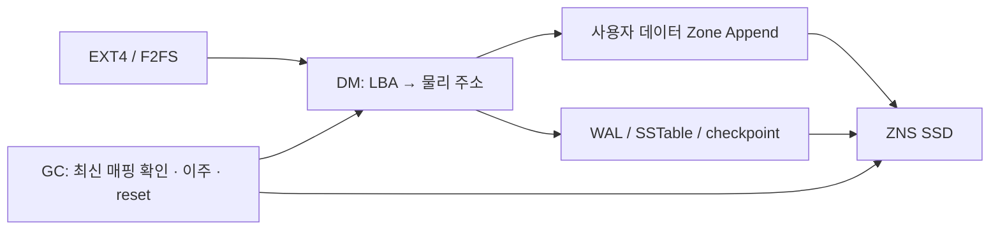

# dm-zns-base

ZNS SSD 위에 일반 블록 장치를 제공하는 Linux Device Mapper 타깃입니다.
EXT4와 F2FS의 임의 논리 쓰기를 Zone Append로 기록하고, LSM-tree 매핑·WAL·checkpoint·GC로
주소 변환과 공간 재사용을 관리합니다. 최종 개발 브랜치는 **`zns_dm/Kovalt03`**입니다.

이 저장소는 DM 구현과 기능 테스트를 관리합니다. Kafka 부하기는 `Kafka-benchmark`,
파일시스템 구성·fio/Kafka 평가·결과 수집은 `kafka_python_result`에서 관리합니다.
FEMU 실험은 team4 게스트 안에서 수행하며 원격 호스트의 장치를 대상으로 하지 않습니다.

## 현재 구현

| 영역 | 동작 |
| --- | --- |
| 쓰기 | 4KiB 정렬 쓰기와 큰 쓰기의 extent Append, 반환된 실제 물리 주소 사용; 부분 쓰기 미지원 |
| WAL | 일반 PUT의 조건부 조기 완료, 요청·그룹·내부 경계에 따른 영속화, 다중 페이지 그룹 |
| 매핑 | active/frozen skiplist, 정렬된 SSTable, sequence 기반 최신 매핑 선택과 k-way compaction |
| 읽기 | 메모리 매핑 우선 조회, SSTable 비동기 이진 탐색, 조회 중 같은 섹터 버퍼 재사용 |
| GC | latest-map 재확인, 조건부 이주 매핑, read pin과 reset 전 잔여 참조 검사 |
| 공간 순환 | reserve seed 차용, GC tail 단독 이관, foreground 양보, WAL·SSTable 회전 |
| discard | 논리 매핑을 tombstone으로 처리하고 WAL에 기록·재생 |
| 계측 | 논리·물리 제출 바이트, GC·flush·compaction, foreground 대기와 매핑 메모리 |

상위 파일시스템에는 conventional 장치로 노출합니다. **DM 위 F2FS**와 **Native ZNS F2FS**는
서로 다른 구성입니다. Native F2FS는 DM을 거치지 않고 ZNS와 보조 CNS 장치를 사용합니다.

여기서 Native F2FS는 본 프로젝트의 multi-device 실험 구성을 뜻합니다.

## I/O와 영속화



### 쓰기와 FLUSH/FUA

1. 정렬·크기·공간 조건을 확인하고 사용자 데이터 영역을 예약합니다.
2. Zone Append 완료 주소로 각 4KiB 논리 블록의 매핑을 구성합니다.
3. 조건을 만족하는 일반 PUT은 매핑과 메모리 WAL에 반영한 뒤 원본 bio를 조기 완료합니다.
4. FUA/PREFLUSH 요청, discard 또는 GC·metadata·공간 압력이 있는 요청은 WAL 영속화 뒤 완료합니다.

4KiB에 정렬되지 않은 쓰기는 RMW로 보완하지 않고 `BLK_STS_NOTSUPP`로 거절합니다.
읽기는 블록 내부 오프셋을 지원하며 블록 경계에서 요청을 나눕니다.

메모리 WAL은 그룹 포화, 명시적인 barrier, memtable flush, GC 진입, WAL 회전과 정상 제거 등의
경계에서 기록합니다. foreground 그룹 기록은 **이전 data/header FLUSH → WAL 기록 → 마지막 페이지의
FUA 완료** 순서를 사용합니다. 다중 페이지 설정에서는 마지막 WAL 페이지의 PREFLUSH로
앞선 페이지도 영속화합니다. 한 페이지 그룹도 WAL의 FUA 완료를 기다립니다.

일반 쓰기의 조기 ACK는 전원 장애 이후의 보존을 뜻하지 않습니다. 파일시스템이 요청하는
FLUSH/FUA가 영속화 계약의 경계이며, DM 자체가 volatile cache를 가짐을 상위에 알립니다.
`wal_batch_delay_ms=0`은 durable waiter의 추가 배치 대기를 없앤 값입니다.
모든 일반 쓰기에 매번 FUA를 강제한다는 의미는 아닙니다.

이전 실험 선택기인 `wal_writeback`, `adaptive_gc`, `sstable_probe_cache`는 제거했습니다.
요청 기반 WAL 정책·압력별 GC·조회 내부 섹터 재사용이 기본 동작이므로 적재 인자로 넘기지 않습니다.

### 읽기·매핑·복구

- active memtable과 frozen memtable을 먼저 확인하고, 이후 SSTable 후보 중 가장 큰 sequence의
  매핑을 선택합니다. SSTable 목록 자체를 항상 최신 순으로 탐색하는 것은 아닙니다.
- 읽기가 참조한 data/SSTable zone을 pin하고 완료 시 해제합니다.
- flush 중에는 frozen map을 유지하며, 공개되지 않은 매핑을 오류로 버리지 않습니다.
- 정상 경로에서는 checkpoint 완료 후 frozen을 해제합니다. 이미 durable한 SSTable이 등록됐다면
  checkpoint 실패 후에도 frozen을 해제할 수 있지만, 실패한 checkpoint로 이전 WAL을 회수하지 않습니다.
- SSTable은 실제 데이터가 아니라 LBA와 물리 주소의 매핑을 담습니다.
- checkpoint는 WAL의 `(generation, offset)` 경계를 기록합니다. 복구에서는 zone ID가 아니라
  generation 순서로 WAL을 재생하고 SSTable 색인을 복원합니다.

온디스크 필드는 little-endian입니다. WAL은 32B 레코드를 사용하며 단일 레코드의 이전 형식과
CRC를 가진 4KiB 페이지 형식을 읽습니다. PUT·GC_PUT·DELETE·DELETE_RANGE·CHECKPOINT를 처리합니다.

### GC와 실행 큐

GC는 닫힌 data zone의 최신 매핑을 다시 확인하고, 데이터와 WAL을 기록한 뒤 조건부로 매핑을
갱신합니다. 원본 zone은 잔여 참조를 확인하고 읽기를 drain한 뒤 reset합니다.
공간이 부족할 때는 data와 WAL workspace를 함께 검사하며 metadata 회전과 foreground에 양보합니다.

GC relocation은 데이터를 기록·FLUSH한 뒤 WAL 페이지들을 일반 Append로 기록하고,
별도 FLUSH가 성공한 후 매핑을 갱신합니다. foreground의 마지막 WAL 페이지 FUA 방식과 구분합니다.
`mapping_put_if_match()`는 active/frozen memtable에 항목이 있으면 예상 이전 PBA와 비교하고,
다른 값이면 이주 매핑을 게시하지 않습니다. 항목이 없으면 삽입하며 SSTable을 직접 조회하지 않습니다.

`wp`는 zone 내부 예약 길이이고 `dispatch_wp`는 제출·취소 회계의 절대 섹터 주소입니다.
Zone Append의 실제 기록 위치는 장치가 결정하며, positional 쓰기는 dispatch gate로 제출 순서를
맞춥니다. 데이터 Append 예약도 매핑 공개 이후 회계에 반영합니다.

| 실행 큐 | 역할 |
| --- | --- |
| `zns_wq` | pending 쓰기·FLUSH 재시도 |
| `zns_bio_wq` | process context에서 실제 bio 제출 |
| `zns_wal_wq` | WAL 배치 기록과 완료 |
| `zns_flush_wq` | frozen memtable 직렬화·SSTable flush |
| `zns_compaction_wq` | SSTable 병합 |
| `zns_gc_wq` | data GC와 WAL 회전 |
| `zns_wal_reclaim_wq` | checkpoint로 보호된 이전 WAL 회수 |

## 빌드와 로컬 검증

C 컴파일러, Python 3와 대상 커널의 빌드 헤더가 필요합니다.

```bash
make -C src W=1

# 다른 커널 헤더를 명시할 때
make -C src KDIR=/lib/modules/대상-커널/build W=1
```

실행 게스트와 모듈의 커널 버전이 일치해야 합니다. 게스트에 적재할 모듈은 해당 게스트용으로
빌드합니다. 로컬 커널용 바이너리를 다른 버전의 FEMU 게스트에 적재하지 않습니다.

다음 검사는 블록 장치를 열거나 모듈을 적재하지 않습니다.

```bash
python3 scripts/test-safety-unit.py
python3 scripts/test-keper-extensions.py
python3 scripts/test-wal-userspace.py
python3 scripts/test-wal-writeback.py
git diff --check

# sparse가 설치되어 있을 때
make -C src W=1 C=2 CHECK=sparse
```

2026-10-29 로컬 검증 기준 총 **39개**입니다: safety 21개, extension 5개, 가상 timer 5개,
writeback 8개입니다. 실제 C helper 실행과 코드 구조 검사를 포함하며, 커널 스케줄링·DMA·
장기 동시성·전원 장애를 대신 검증하지는 않습니다.

## FEMU 게스트에서 사용

다음은 **새로 실행한 전용 FEMU 게스트의 물리 32GiB·zone 512MiB 장치**에 논리 24GiB 타깃을
만드는 예시입니다. 기존 실험이나 마운트가 있는 장치에서 그대로 실행하지 않습니다.
장치 초기화와 파일시스템 생성은 기존 평가 runner를 사용하는 것이 기본 흐름입니다.

```bash
# 장치 모델·용량·zone 구성을 먼저 확인합니다.
lsblk -o NAME,SIZE,MODEL,MOUNTPOINTS
sudo blkzone report /dev/nvme0n1

ZNS_DEV=/dev/nvme0n1
DM_NAME=kafka-zns

sudo insmod src/dm-zns-base.ko \
    metrics_enabled=1 \
    gc_reserved_zones=8 gc_low_watermark=16 gc_high_watermark=20
printf '0 50331648 zns-base %s\n' "$ZNS_DEV" | sudo dmsetup create "$DM_NAME"
sudo dmsetup status "$DM_NAME"
```

50331648은 512B 섹터 기준 24GiB입니다. allocator는 하위 물리 공간 전체를 관리하며,
논리 주소 범위와 free zone 수는 서로 다른 값입니다. 이 예시의 8/16/20은 512MiB zone용
실험 설정이며 모듈 기본값 2/4/5나 이전 benchmark4 설정과 구분합니다.

파일시스템 생성은 데이터를 지웁니다. 아래 둘 중 사용할 구성 하나만 선택합니다.

```bash
# EXT4, discard 비활성화
sudo mkfs.ext4 -F -E nodiscard /dev/mapper/kafka-zns
sudo mkdir -p /mnt/kafka-zns
sudo mount -t ext4 -o nodiscard /dev/mapper/kafka-zns /mnt/kafka-zns
```

```bash
# F2FS, discard 비활성화
sudo mkfs.f2fs -f -t 0 /dev/mapper/kafka-zns
sudo mkdir -p /mnt/kafka-zns
sudo mount -t f2fs -o nodiscard /dev/mapper/kafka-zns /mnt/kafka-zns
```

사용이 끝나고 관련 작업을 모두 종료한 뒤 정상 제거합니다.

```bash
sudo umount /mnt/kafka-zns
sudo dmsetup remove kafka-zns
sudo rmmod dm_zns_base
```

`nullblk-up.sh`와 `test.sh`는 별도의 폐기 가능한 로컬 VM용 장치 테스트입니다.
zone reset·mkfs·모듈 교체를 수행하며, 현재 타깃에는 4KiB Zone Append 지원이 필요합니다.
`test.sh`의 기본 범위는 M1~M11이고 초기 zone 전달 설계의 M0는 참고용으로 분리했습니다.
재적재 테스트가 정상 dtr을 거친다는 점도 실제 전원 차단과 구분해야 합니다.

## 주요 설정과 계측

| 파라미터 | 기본값 | 의미 |
| --- | ---: | --- |
| `flush_threshold` | 1,000,000 | memtable flush를 요청하는 엔트리 수; 메모리의 엄격한 상한은 아님 |
| `compaction_k` | 4 | 한 번에 병합할 오래된 SSTable 수 |
| `gc_reserved_zones` | 2 | 일반 할당에서 보호하는 free zone 수 |
| `gc_low_watermark` / `gc_high_watermark` | 4 / 5 | GC 시작·회수 목표 |
| `data_append_max_blocks` | 64 | 요청당 최대 4KiB 블록 수, 기본 상한 256KiB; 장치 한도로 추가 제한 |
| `wal_batch_max_records` | 127 | WAL 페이지당 레코드 수 |
| `wal_group_pages` | 8 | WAL 그룹 페이지 수, 허용 범위 1~16 |
| `wal_batch_delay_ms` | 0 | durable waiter의 배치 대기(ms) |
| `metrics_enabled` / `wal_timing_enabled` | 0 / 0 | 누적 계측과 WAL 단계별 진단 |
| `gc_diag_budget` | 0 | GC mapping audit 출력 예산 |
| `failpoint` / `wal_batch_alloc_failures` | 0 / 0 | 별도 장애 주입용 설정 |

크기 설정은 온디스크 형식·장치 한도와 맞춰야 합니다. 정상 성능 평가에서는 장애 주입을 끕니다.
`wal_timing_enabled`는 `metrics_enabled`와 함께 사용합니다.

기본 `127 × 8 = 1,016` 레코드는 worker가 한 배치에서 처리하는 상한입니다.
전체 pending WAL queue의 절대 상한을 뜻하지 않습니다. `data_append_max_blocks`의 허용 범위는
1~256이며, 실제 Append 크기는 장치 한도로도 제한됩니다.

`dmsetup status`의 카운터는 구간 시작·끝의 차분으로 계산합니다.

| 계측 | 해석 |
| --- | --- |
| `logical_write_bytes`, `logical_read_bytes` | DM 진입 I/O 바이트. Kafka payload와 다름 |
| `user_write_bytes`, `gc_write_bytes`, `wal_write_bytes`, `sstable_write_bytes` | 종류별 하위 쓰기 제출량. NAND program 양이 아님 |
| `gc_runs` / `gc_reclaims` / `gc_moved_bytes` | worker 실행 / data zone 회수 / 성공 회수 시 집계한 이주량 |
| `flush_*`, `compaction_*` | 실행·시간·입출력 비용 |
| `foreground_wait_*` | pending foreground 대기. Kafka ACK 지연과 다름 |
| `mapping_resident_bytes`, `mapping_sampled_peak_bytes` | 매핑 메모리와 조회 시점의 최대값. 전체 모듈의 정확한 순간 peak는 아님 |
| `*_scratch_requested_bytes` | GC·compaction 임시 버퍼 요청량 |

```text
DM WA = Δ(user_write_bytes + gc_write_bytes + wal_write_bytes + sstable_write_bytes)
        / Δlogical_write_bytes
```

논리 쓰기가 0이면 WA를 계산하지 않습니다. DM WA, 파일시스템 GC, FEMU NAND 통계는
계층과 분모가 다르므로 값이나 횟수를 그대로 비교하지 않습니다.

## 파일 구성과 참고 문서

```text
dm-zns-base/
├── src/          DM 타깃 본체, skiplist, 모듈 Makefile
├── scripts/      사용자 공간 회귀, 장치 기능 테스트, 개발 보조 스크립트
├── docs/         프로젝트 개요와 설계·설정 문서
├── Vagrantfile   개발 VM 구성
└── provision.sh  VM 패키지 설치
```

- [프로젝트 개요와 환경 구성](docs/project-overview.md)
- [빌드와 실행](docs/06-build-and-run.md)
- [LSM-tree 아키텍처](docs/10-lsm-tree-architecture.md)

요청 기반 WAL·extent Append·그룹 기록·조회 버퍼 재사용·압력별 GC는 같은 저장소의
`zns_dm/keper1212` 구현에서 설계와 제어 흐름을 참고했습니다. 함수 본문을 그대로 복사하지 않고
이 타깃의 Zone Append·skiplist·WAL 형식과 bio 소유권 구조에 맞춰 구현했습니다.

이전 설계 문서에는 당시 단계의 설명이 남아 있을 수 있습니다. 현재 옵션과 I/O 순서는
이 README와 실제 소스를 기준으로 확인합니다. 라이선스는 GPL-2.0이며 소스의 SPDX 표기를 따릅니다.
